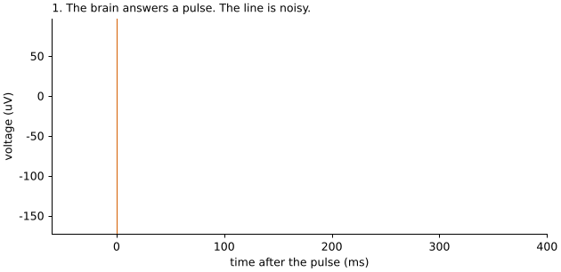
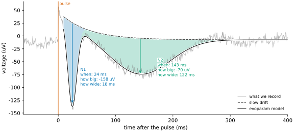
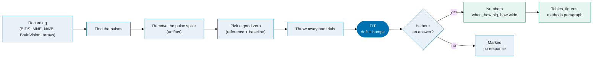
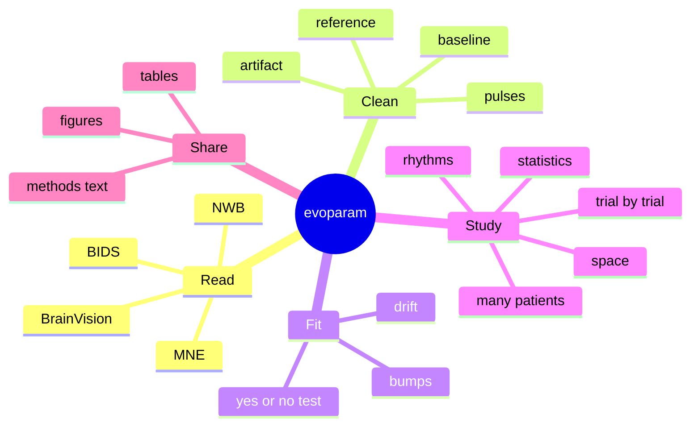

<a id="readme-top"></a>

<div align="center">

<picture>
  <source media="(prefers-color-scheme: dark)" srcset="figures/readme/banner-dark.svg">
  <source media="(prefers-color-scheme: light)" srcset="figures/readme/banner-light.svg">
  
</picture>

<br>

**evoparam** stands for **evoked response parameterization**. You poke the brain, the brain answers with a wiggle.<br>
evoparam turns each wiggle into a few clear numbers: **when**, **how big**, **how wide**.

<br>

[](https://www.uab.edu/engineering/ece/people/faculty/rachel-smith)

[](pyproject.toml)
[](LICENSE)
[](pyproject.toml)
[](https://github.com/astral-sh/ruff)
[](#install-it)
[](#research-use-only)
[](https://github.com/yannbellec/evoparam/commits/main)

<br>

<a href="https://yannbellec.github.io/evoparam/auto_tutorials/index.html"></a>

<br>

[**Tutorials**](https://yannbellec.github.io/evoparam/auto_tutorials/index.html) &nbsp;&bull;&nbsp;
[**What it does**](#what-does-evoparam-do) &nbsp;&bull;&nbsp;
[**Install**](#install-it) &nbsp;&bull;&nbsp;
[**First fit**](#your-first-fit-in-4-lines) &nbsp;&bull;&nbsp;
[**Toolbox**](#the-toolbox) &nbsp;&bull;&nbsp;
[**The lab**](#made-at-the-neural-signal-processing-and-modeling-lab) &nbsp;&bull;&nbsp;
[**Cite**](#cite-it)

</div>

<br>

> [!NOTE]
> **evoparam is a tool of the [Neural Signal Processing and Modeling Lab](https://www.uab.edu/engineering/ece/people/faculty/rachel-smith)**
> (Department of Electrical and Computer Engineering, University of Alabama at Birmingham),
> led by **Dr. Rachel June Smith**. It is written and kept by Yann V. Bellec, PhD student in the lab.

<br>

## Table of contents

<details open>
<summary><b>Open / close</b></summary>

1. [evoparam in one picture](#evoparam-in-one-picture)
2. [What does evoparam do?](#what-does-evoparam-do)
3. [The idea, drawn by hand](#the-idea-drawn-by-hand)
4. [The path of your data](#the-path-of-your-data)
5. [Install it](#install-it)
6. [Your first fit in 4 lines](#your-first-fit-in-4-lines)
7. [Learn it: the tutorials](#learn-it-the-tutorials)
8. [The toolbox](#the-toolbox)
9. [Ready-made settings for many kinds of answers](#ready-made-settings-for-many-kinds-of-answers)
10. [Turn it in 3D](#turn-it-in-3d)
11. [The command line](#the-command-line)
12. [Made at the Neural Signal Processing and Modeling Lab](#made-at-the-neural-signal-processing-and-modeling-lab)
13. [Cite it](#cite-it)
14. [Research use only](#research-use-only)
15. [Help and community](#help-and-community)

</details>

<br>

## evoparam in one picture

<div align="center">

<br>
<sub><b>Watch it work.</b> Grey: what the electrode records. Dashed: the slow drift. Blue: the first bump (N1). Green: the second bump (N2). Black: the model. Made with <code>tools/make_readme_figures.py</code>.</sub>
</div>

<p align="right">(<a href="#readme-top">back to top</a>)</p>

## What does evoparam do?

**The story in four sentences.**

1. You give the brain a tiny pulse (a sound, a flash, a small electric current).
2. Electrodes record the answer: a wiggly line, with noise on top.
3. Inside the wiggle hide a few **bumps**. Each bump is a group of brain cells answering together.
4. evoparam finds each bump and tells you **when** it happens, **how big** it is and **how wide** it is, with error bars.

<div align="center">

<br>
<sub><b>One answer, cut into its parts.</b> Every number here is written by evoparam, not by hand.</sub>
</div>

<br>

| You have... | evoparam gives you... |
| :--- | :--- |
| a messy wiggle | a clean **model** of it |
| "is there even an answer?" | a **yes / no test**, with a p-value |
| one electrode | the bumps of that electrode |
| hundreds of electrodes | one **table**, one row per bump |
| many trials | how each bump **moves from trial to trial** |
| many patients | one model for the **whole group** |
| a paper to write | the **methods paragraph** and the citations |

<p align="right">(<a href="#readme-top">back to top</a>)</p>

## The idea, drawn by hand

```text
  voltage (uV)
      ^
      |       pulse
   +  |         |.
      |         | '.     <- slow drift: the leftover of the pulse, fading away
   0  +---------+---\----.----------------------------------------......______
      |         |    \  / '.                                 ..''
      |         |     \/    '.                           ..''
      |         |     N1      '.           N2         ..''
   -  |         |   sharp,      '.____________________.'
      |         |   fast bump        big, slow bump
      +---------+------------------------------------------------------------> time (ms)
                0   25                      150                         400

  what you record  =  slow drift  +  bump N1  +  bump N2  +  noise
```

In one line of math (that is all the math you need):

$$\text{signal}(t) \;=\; \text{drift}(t) \;+\; \sum_{k} \text{bump}_k(t) \;+\; \text{noise}(t)$$

Each $\text{bump}_k$ is described by 3 numbers: its **time** (latency), its **size** (amplitude) and its **width**.

<p align="right">(<a href="#readme-top">back to top</a>)</p>

## The path of your data



> [!TIP]
> You can do every step yourself (tutorial 08), or let one call do them all with the settings of a preset:
> `evoparam.fit(trials, preset="ccep")`.

<p align="right">(<a href="#readme-top">back to top</a>)</p>

## Install it

evoparam is not on PyPI yet. Install it straight from GitHub:

```bash
pip install "evoparam[plot] @ git+https://github.com/yannbellec/evoparam"
```

<details>
<summary><b>For developers (editable install and tests)</b></summary>

```bash
git clone https://github.com/yannbellec/evoparam
cd evoparam
pip install -e ".[all]"
pytest
```

`python tools/run_all_tests.py` runs the whole suite, slow and network tests included.

</details>

<details>
<summary><b>Google Colab</b></summary>

```python
!pip install "evoparam[plot] @ git+https://github.com/yannbellec/evoparam"
```

</details>

<details>
<summary><b>Which extras do I need?</b></summary>

| Extra | Adds |
| :--- | :--- |
| *(none)* | the core: NumPy and SciPy only |
| `plot` | figures (matplotlib) |
| `mne`, `bids`, `nwb` | readers for MNE objects, BIDS datasets and NWB files |
| `data` | tables (pandas) and dataset downloads |
| `fast` | a compiled fit (numba) |
| `bayes` | full Bayesian group models (numpyro or PyMC) |
| `all` | everything above, and more (`stats`, `stream`, `sklearn`, `cli`, ...) |

</details>

<p align="right">(<a href="#readme-top">back to top</a>)</p>

## Your first fit in 4 lines

No data? No problem. evoparam can **make** a fake brain answer, then **find** its bumps again.

```python
from evoparam import fit_response, gen_response, plot_fit

times, signal = gen_response([[25, -150, 20], [150, -80, 120]], seed=0)  # fake answer
fit = fit_response(times, signal, preset="ccep")  # find bumps
plot_fit(fit)  # look
```

Each bump is written `[when (ms), how big (uV), how wide (ms)]`. What evoparam finds again:

```text
N1   latency  24.4 ms   amplitude  -158 uV   width  18 ms
N2   latency 143.1 ms   amplitude   -70 uV   width 122 ms
```

<details>
<summary><b>The same on real data (one call for every electrode)</b></summary>

```python
import evoparam

trials = evoparam.io.read("ds004080", subject="ccepAgeUMCU01")  # OpenNeuro data
group = evoparam.fit(trials, preset="ccep")  # every electrode
table = group.to_dataframe()  # one row per bump
print(group.methods_text())  # methods paragraph
```

The table has error bars and the yes / no test for each electrode; the methods paragraph comes with its citations.

`examples/ccep_pipeline.py` runs the whole path on one patient of the open dataset
[ds004080](https://openneuro.org/datasets/ds004080) (it reads about 55 MB of a 2 GB file).

</details>

<p align="right">(<a href="#readme-top">back to top</a>)</p>

## Learn it: the tutorials

<div align="center">
<a href="https://yannbellec.github.io/evoparam/auto_tutorials/index.html"></a>
</div>

<br>

22 short lessons, in order, from "what is a bump?" to group statistics. Every lesson runs on its own.

<table>
<tr><th>Start here</th><th>Real data</th><th>Going further</th></tr>
<tr valign="top"><td>

01 [Model description](https://yannbellec.github.io/evoparam/auto_tutorials/plot_01_model_description.html)<br>
02 [Reading the results](https://yannbellec.github.io/evoparam/auto_tutorials/plot_02_reading_results.html)<br>
03 [Fitting algorithm](https://yannbellec.github.io/evoparam/auto_tutorials/plot_03_fitting_algorithm.html)<br>
04 [Component fitting](https://yannbellec.github.io/evoparam/auto_tutorials/plot_04_component_fitting.html)<br>
05 [Background fitting](https://yannbellec.github.io/evoparam/auto_tutorials/plot_05_background_fitting.html)<br>
06 [Metrics](https://yannbellec.github.io/evoparam/auto_tutorials/plot_06_metrics.html)<br>
07 [The fit object](https://yannbellec.github.io/evoparam/auto_tutorials/plot_07_fit_object.html)

</td><td>

08 [Groups of electrodes](https://yannbellec.github.io/evoparam/auto_tutorials/plot_08_groups_real_data.html)<br>
09 [Trial by trial](https://yannbellec.github.io/evoparam/auto_tutorials/plot_09_trial_by_trial.html)<br>
10 [Tuning the fit](https://yannbellec.github.io/evoparam/auto_tutorials/plot_10_tuning_the_fit.html)<br>
11 [Further analysis](https://yannbellec.github.io/evoparam/auto_tutorials/plot_11_further_analysis.html)<br>
12 [Reporting](https://yannbellec.github.io/evoparam/auto_tutorials/plot_12_reporting.html)<br>
13 [Your own data](https://yannbellec.github.io/evoparam/auto_tutorials/plot_13_your_own_data.html)<br>
14 [Removing the artifact](https://yannbellec.github.io/evoparam/auto_tutorials/plot_14_removing_the_artifact.html)

</td><td>

15 [Is there a response?](https://yannbellec.github.io/evoparam/auto_tutorials/plot_15_is_there_a_response.html)<br>
16 [Time-frequency](https://yannbellec.github.io/evoparam/auto_tutorials/plot_16_time_frequency.html)<br>
17 [Statistics](https://yannbellec.github.io/evoparam/auto_tutorials/plot_17_statistics.html)<br>
18 [Across subjects](https://yannbellec.github.io/evoparam/auto_tutorials/plot_18_across_subjects.html)<br>
19 [Beyond CCEP](https://yannbellec.github.io/evoparam/auto_tutorials/plot_19_beyond_ccep.html)<br>
20 [Command line](https://yannbellec.github.io/evoparam/auto_tutorials/plot_20_command_line.html)<br>
21 [Online mode](https://yannbellec.github.io/evoparam/auto_tutorials/plot_21_online_mode.html)<br>
22 [Shapes and maps](https://yannbellec.github.io/evoparam/auto_tutorials/plot_22_spatial.html)

</td></tr>
</table>

<p align="right">(<a href="#readme-top">back to top</a>)</p>

## The toolbox

Each box does one job. You can use one box alone, or all of them in a row.

| Box | What it does, in plain words |
| :--- | :--- |
| `evoparam.io` | **Opens your files** (BIDS, BrainVision, MNE, NWB), even a few seconds of a big file on the internet. |
| `evoparam.events` | **Finds the pulses** in the signal when the list of pulses is missing or wrong. |
| `evoparam.artifact` | **Erases the spike of the pulse itself**, so it does not hide the brain answer. |
| `evoparam.prep` | **Cleans up**: a good zero (reference, baseline), bad trials out, filters. |
| `evoparam.models` | **The heart**: finds the drift and the bumps, with error bars. |
| `evoparam.existence` | **Says yes or no**: is there really an answer on this electrode? |
| `evoparam.trials` | **Follows each bump trial by trial**: does it move, does it grow? |
| `evoparam.stats` | **The numbers a paper needs**: confidence intervals, comparisons, reliability. |
| `evoparam.hierarchical` | **One model for trials, electrodes and patients** at once. |
| `evoparam.tf` | **Looks at rhythms** (time-frequency): which brain waves get louder, and when. |
| `evoparam.spatial` | **Looks across space**: shapes shared by electrodes, maps, links between sites. |
| `evoparam.presets` | **Ready-made settings** for each kind of brain answer (see below). |
| `evoparam.reports`, `evoparam.plots` | **Figures, tables, HTML reports and the methods paragraph.** |
| `evoparam.stream` | **Live mode**: fits answers while the recording is still running. |



<p align="right">(<a href="#readme-top">back to top</a>)</p>

## Ready-made settings for many kinds of answers

A **preset** is a recipe: where to look, which shapes to try, what to call each bump. Pick the one that matches your experiment.

| Preset | The answer it is made for |
| :--- | :--- |
| `erp` | brain waves on the scalp after a sound or an image (EEG) |
| `ccep` | answer of one brain area when another is stimulated, grid electrodes (ECoG) |
| `ccep_seeg` | the same, with depth electrodes (sEEG) |
| `sep` | answer to a touch or a nerve pulse (somatosensory) |
| `tep` | answer to a magnetic pulse on the head (TMS-EEG) |
| `erna` | answer of deep brain stimulation (evoked resonant neural activity) |
| `ecap` | answer of the spinal cord to stimulation |
| `ecap_ci` | answer of the hearing nerve to a cochlear implant |
| `rodent_ep`, `primate_ep` | answers recorded in animals (LFP) |
| `p300_bci` | the P300 wave used by brain-computer interfaces |

All presets are plain JSON files with their sources. `presets.derive` makes your own variant and remembers where it came from.

<p align="right">(<a href="#readme-top">back to top</a>)</p>

## Turn it in 3D

> [!TIP]
> Click **[figures/readme/response_surface.stl](figures/readme/response_surface.stl)**: GitHub opens a 3D view that you can **turn, zoom and move with the mouse**.

It shows the answer of 28 electrodes at once (simulated): left to right is **time**, front to back is **distance from the stimulated spot**, up and down is **voltage**. Near the pulse, the N1 is deep and early. Far away, it gets smaller and later.

<p align="right">(<a href="#readme-top">back to top</a>)</p>

## The command line

No Python needed for the main jobs:

```bash
evoparam fit ./my_bids_dataset --sub 01 --preset ccep --out derivatives/   # fit every electrode
evoparam report derivatives/                                              # build the HTML report
evoparam simulate --modality erp --out fake_data/                         # make test data
evoparam presets list                                                     # show the presets
evoparam cite                                                             # what to cite
evoparam --help                                                           # all 13 commands
```

<p align="right">(<a href="#readme-top">back to top</a>)</p>

## Made at the Neural Signal Processing and Modeling Lab

<table>
<tr>
<td width="62%" valign="top">

**evoparam is built at the Neural Signal Processing and Modeling Lab**, directed by
**Dr. Rachel June Smith**, Department of Electrical and Computer Engineering,
University of Alabama at Birmingham (UAB).

The lab builds computational tools that turn brain signals into numbers, so that brain
disease can be described more objectively and more accurately. evoparam is one of these
tools: it gives every team the same clear, repeatable way to describe evoked brain answers.

- Lab PI: [Dr. Rachel June Smith](https://www.uab.edu/engineering/ece/people/faculty/rachel-smith)
- Lead developer: Yann V. Bellec (PhD student)

</td>
<td width="38%" valign="top">

```text
  _   _  ____  ____  __  __
 | \ | |/ ___||  _ \|  \/  |
 |  \| |\___ \| |_) | |\/| |
 | |\  | ___) |  __/| |  | |
 |_| \_||____/|_|   |_|  |_|

  Neural Signal Processing
  and Modeling Lab
  PI: Rachel June Smith
```

</td>
</tr>
</table>

<p align="right">(<a href="#readme-top">back to top</a>)</p>

## Cite it

If evoparam helps your work, please cite it. GitHub shows a **"Cite this repository"** button (top right), made from [CITATION.cff](CITATION.cff). You can also run:

```bash
evoparam cite
```

<details>
<summary><b>BibTeX</b></summary>

```bibtex
@software{evoparam,
  author       = {Bellec, Yann V.},
  title        = {evoparam: parameterizing evoked neural responses},
  organization = {Neural Signal Processing and Modeling Lab, University of Alabama at Birmingham},
  url          = {https://github.com/yannbellec/evoparam},
  version      = {0.1.0},
  year         = {2026}
}
```

</details>

Where the code comes from: [NOTICE](NOTICE) and [LICENSE](LICENSE). Packages it uses: [THIRD_PARTY.md](THIRD_PARTY.md). Methods rewritten from papers: [REIMPLEMENTED.md](REIMPLEMENTED.md).

<p align="right">(<a href="#readme-top">back to top</a>)</p>

## Research use only

> [!WARNING]
> evoparam is a **research preview** (version 0.1). It is **not a medical device**. Its outputs are not meant for diagnosis or treatment decisions.

<p align="right">(<a href="#readme-top">back to top</a>)</p>

## Help and community

| I want to... | Go to |
| :--- | :--- |
| learn evoparam | the [tutorials](https://yannbellec.github.io/evoparam/auto_tutorials/index.html) |
| report a bug | the [issue tracker](https://github.com/yannbellec/evoparam/issues) |
| add a preset, a shape or a reader | [CONTRIBUTING.md](CONTRIBUTING.md) |
| know the rules | [CODE_OF_CONDUCT.md](CODE_OF_CONDUCT.md), [GOVERNANCE.md](GOVERNANCE.md), [SECURITY.md](SECURITY.md), [SUPPORT.md](SUPPORT.md), [TRADEMARK.md](TRADEMARK.md) |

<br>

<div align="center">
<sub>
<b>evoparam</b> &bull; a tool of the <b>Neural Signal Processing and Modeling Lab</b> (PI: Rachel June Smith), University of Alabama at Birmingham &bull; Apache-2.0
</sub>
</div>
